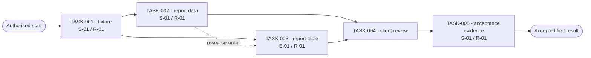
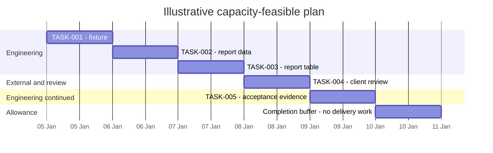

# Critical-path examples

These examples are teaching material for the [map-critical-path skill](./SKILL.md). They are deliberately fictional. The story and requirement identifiers show the traceability that a real task needs, but the linked records are not present in this example directory.

The effort values below are illustrative planning proxies in engineer-hours. They are not promises, elapsed delivery time, or calibrated probabilities. External waits are recorded separately from engineer effort.

## Capacity can add a dependency

Assume four validated implementation tasks contribute to story `S-01` and requirement `R-01`. One engineer has four available hours per working day. `TASK-002` and `TASK-003` can technically start after `TASK-001`, but they cannot run at the same time because they use the same engineer.

| Task | Central effort | Technical predecessors | Additional scheduling information |
| --- | ---: | --- | --- |
| `TASK-001` - prepare acceptance fixture | 4 hours | None | Creates the fixture used by both implementation tasks. |
| `TASK-002` - expose report data | 4 hours | `TASK-001` | Must finish before the client review. |
| `TASK-003` - render report table | 4 hours | `TASK-001` | Add a resource-order predecessor from `TASK-002` because one engineer is shared. |
| `TASK-004` - client review | 0 engineer hours | `TASK-002`, `TASK-003` | One external calendar day owned by the named client acceptor. |
| `TASK-005` - record acceptance evidence | 4 hours | `TASK-004` | Closes the finish milestone when the acceptance record is complete. |

The dependency-only network is shorter because `TASK-002` and `TASK-003` appear concurrent. The capacity-feasible network adds the dashed resource-order link and schedules them serially:

| Scenario | Engineer effort | Capacity-feasible elapsed time | Assumption |
| --- | ---: | ---: | --- |
| Lower | 12 hours | 4 working days | Three engineering days followed by one review day. |
| Central | 16 hours | 5 working days | Four engineering days followed by one review day. |
| Upper | 24 hours | 8 working days | Six engineering days and a two-day client review window. |

For the central case, the critical path is `TASK-001 -> TASK-002 -> TASK-003 -> TASK-004 -> TASK-005`. The dependency-only result would forecast four working days, but the selected capacity-feasible planning target might be six working days with one clearly labelled completion buffer. The extra day is an allowance for the stated exposure; it is not hidden implementation work and does not change the central forecast.

The corresponding schedule makes the external wait and buffer visible:

## Examples of decisions that fail the gate

- `TASK-006` has an unknown duration written as `0 days`. Reject it. Create a bounded investigation task instead, such as `Confirm the export permission and sample-data shape` with a 2-4 engineer-hour allowance, an engineer owner and a data-owner review on completion, then schedule the implementation after its result.
- `TASK-002` is labelled `Must` in MoSCoW. That does not put it on the critical path. Priority determines release scope; dependencies, durations, capacity and external waits determine the path.
- The client review is recorded as eight engineer-hours. Correct it by recording the engineer effort, the client-owned elapsed wait, and the calendar assumption in separate fields.
- `TASK-002` depends on `TASK-003` while `TASK-003` also depends on `TASK-002`. Reject the network until the cycle is resolved; do not calculate earliest or latest dates from a cyclic graph.
