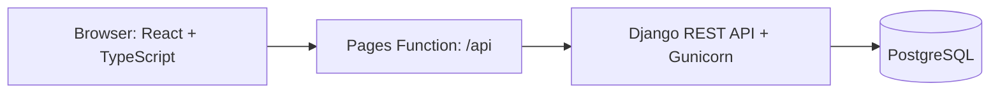

# Cooldown Counter

**A shared workspace for tracking CS2 cooldowns and their history.**

[](https://github.com/gingerchicken/cooldown-counter/actions/workflows/ci.yaml)

Track Steam accounts, record cooldown observations and manage escalation rules
across separate fleets. Django handles login, permissions and rule evaluation.
React uses a generated TypeScript API client to keep the interface aligned with
[the backend contract](backend/openapi.json).

[Quick start](#quick-start) |
[Features](#features) |
[Development](#development) |
[Tests](#tests-and-acceptance) |
[Documentation](#documentation) |
[Deployment](#deployment)

## Quick start

You need **Git** and **Docker with Compose 2.24.4 or newer**. Python, Node,
PostgreSQL, Redis and browser test tools run in containers.

### 1. Start the application

```bash
# Create a local checkout for the application and its Docker configuration.
git clone https://github.com/gingerchicken/cooldown-counter.git
cd cooldown-counter
```

If another checkout uses the default ports or project name, set your
[local configuration](#optional-local-configuration) before starting the stack.

```bash
# Build the images, generate the API client, apply migrations and start the stack.
./local-dev.sh up
```

The first start installs the locked dependencies and builds the images.

### 2. Create your login

In another terminal, from the same checkout:

```bash
# Provision an ordinary operator; enter the password at the hidden prompts.
./local-dev.sh operator --username alice
```

There are no default credentials. This creates an ordinary Django account.
Use `./local-dev.sh user` when you need a Django superuser.

### 3. Create your first fleet

Open **[localhost:5173](http://localhost:5173)** and sign in with your new account.

1. Create a fleet. It starts with five offence types and no accounts.
2. Review the default rules for your fleet.
3. Add a Steam account using its exact 17-digit SteamID and a readable tag.
4. Record its first cooldown, review the prediction and save the observation.
5. Provision colleagues with the operator command, then add them as fleet members.

| Local address | Purpose |
| --- | --- |
| [localhost:5173](http://localhost:5173) | Vite development server with live frontend updates |
| [localhost:8788](http://localhost:8788) | Built frontend served through local Cloudflare Pages tooling |

Both routes use the real Pages Function and Django API. The built frontend on
port 8788 needs a rebuild to reflect frontend changes; use port 5173 while editing.

### Optional local configuration

If another checkout uses the default project name or ports, copy
[`.env.example`](.env.example) to `.env` and choose different values:

```dotenv
# Give this checkout its own containers, network and persistent volumes.
COMPOSE_PROJECT_NAME=cooldown-counter

# Choose free host ports for live development and the built frontend.
LOCAL_DEV_PORT=5174
LOCAL_WEB_PORT=8789
```

Keep those settings for subsequent commands so they address the same stack.
The supplied defaults bind development ports to the host loopback interface.

## Features

- **Separate fleets.** Switch between fleets with explicit owner, editor and
  viewer membership.
- **Accounts and calendar.** Search by tag or SteamID, filter cooldowns by
  account, status or offence, and inspect history and step-down forecasts.
- **Reviewed reporting.** Keep cooldown start and observation time separate.
  Preview the next step before saving, or choose a manual override with a reason.
- **Versioned rules.** Edit offence ladders and decay policies while preserving
  the versions used for existing assessments.
- **Retained evidence.** Add observations to an existing cooldown without
  advancing its ladder again. Archive offence types without deleting history.
- **Conflict handling.** Refresh a preview when history or policy changes.
  Retrying the same accepted request does not create duplicate evidence.
- **Attributed changes.** Inspect fleet audit entries to see who made a change.

**Ordinary competitive cooldowns** share one level across Abandoning, Team
Damage and Kicking for each tracked account. Repeats can raise the level above
four while the duration stays at seven days. Importing a seven-day penalty by
manual override records level four or higher and suppresses an exact recovery
date. A first prediction assumes the recorded history is complete.

**VACNet and grief reports** use the observed game timer. Enter the time you saw
it and the remaining minutes. You can record whether VACNet flagged the account
or someone it queued with. A griefing warning can be logged without creating
a restriction. A new game timer can move the displayed expiry while preserving the
original prediction and previous readings.

**Existing fleets** keep their custom rules and history after migration. To
adopt shared competitive rules, edit each applicable offence type, select the
ordinary competitive mechanism and save. Select the VACNet or griefing
mechanism for those notices. The new policy applies to future reports. Earlier
custom events remain available as recorded and do not seed a hidden game level. Add other qualifying reasons, such as an issued inactivity cooldown,
with the ordinary competitive mechanism to share the same progression.

See the [CS2 cooldown model review](docs/cs2-cooldown-model-review.md) for the
Valve sources and the limits of these predictions.
All date/time inputs are labelled **UTC**. Durations use whole minutes.
See the [time and history rules](docs/data-model.md#time-and-history) for decay,
overlap, backdated evidence and validation behavior.

### Fleet permissions

| Capability | Owner | Editor | Viewer |
| --- | --- | --- | --- |
| Read fleet accounts, rules, history and audit entries | Yes | Yes | Yes |
| Manage accounts, rules and cooldown evidence | Yes | Yes | No |
| Add members, change roles and remove members | Yes | No | No |

An operator can belong to multiple fleets. Django staff and superuser status do
not grant implicit fleet access. Each fleet must retain at least one owner.
Public signup and password recovery are not included.

## Development

### Architecture



The backend uses Django REST Framework and PostgreSQL. The frontend uses React,
TypeScript and Vite. Redis, Celery and Beat support the retained background-job
and scheduler infrastructure checks. A single backend image runs the API,
worker, scheduler and migration roles in separate containers.

See [architecture and boundaries](docs/architecture.md) and the
[ER diagram](docs/data-model.md#entity-relationship-diagram) for the detailed design.

### Repository layout

| Path | Responsibility |
| --- | --- |
| [`backend/tracker/`](backend/tracker/) | Fleet models, prediction, services, queries, serializers and HTTP views |
| [`backend/accounts/`](backend/accounts/) | Django session login, logout and CSRF endpoints |
| [`backend/platform_tools/`](backend/platform_tools/) | Operator provisioning and validated schema generation |
| [`backend/tests/`](backend/tests/) | Backend unit, API, concurrency and deployment contract tests |
| [`frontend/src/tracker/`](frontend/src/tracker/) | Workspace components, presentation helpers and colocated tests |
| [`frontend/packages/api-client/`](frontend/packages/api-client/) | Generated contract and shared cookie/CSRF transport |
| [`frontend/e2e/`](frontend/e2e/) | Playwright tests against the complete Docker stack |
| [`frontend/tooling/`](frontend/tooling/) | API watcher and acceptance evidence validator |
| [`deploy/k8s/`](deploy/k8s/) | Shared Kubernetes base and staging/production overlays |

### Automatic API updates

`./local-dev.sh up` exports Django's OpenAPI schema, generates TypeScript
declarations and builds the client package. Development watchers then regenerate
after backend edits and rebuild after schema or client-source changes. Invalid
edits leave the last valid generated contract intact; correcting them triggers
another attempt.

When the watchers are stopped, regenerate explicitly:

```bash
# Refresh the backend contract and rebuild its generated TypeScript client.
./local-dev.sh api-client
```

Commit both [`backend/openapi.json`](backend/openapi.json) and
[`schema.d.ts`](frontend/packages/api-client/src/schema.d.ts) after an API change.
CI rejects generated contract drift. Do not edit either generated file by hand.
The shared client handles session cookies and CSRF; rule evaluation stays in Python.

### Common commands

| Command | Purpose |
| --- | --- |
| `./local-dev.sh up` | Build and start development with source and API watchers |
| `./local-dev.sh down` | Stop development while retaining stored data |
| `./local-dev.sh logs` | Follow service logs |
| `./local-dev.sh logs backend api-schema-watch api-client-watch` | Inspect backend and API-generation logs |
| `./local-dev.sh operator --username bob` | Provision an ordinary operator |
| `./local-dev.sh user` | Create a Django superuser |
| `./local-dev.sh django check` | Run Django system checks |
| `./local-dev.sh django makemigrations` | Generate migrations inside Docker |
| `./local-dev.sh migrate` | Apply database migrations |
| `./local-dev.sh shell` | Open the Django shell |
| `./local-dev.sh help` | List supported commands |

**Data removal:** `./local-dev.sh reset --yes` deletes this development project's
containers and data. Use `down` for normal shutdown.

## Tests and acceptance

Run the complete local verification with:

```bash
# Run every test layer, then verify the combined acceptance evidence.
./local-dev.sh test all
```

| Command | Checks |
| --- | --- |
| `./local-dev.sh test backend` | Ruff, pytest, PostgreSQL concurrency, coverage, Django checks and migration drift |
| `./local-dev.sh test frontend` | ESLint, TypeScript, unit/tooling tests, production build and Pages Function compilation |
| `./local-dev.sh test browser` | Component tests in real Chromium through Playwright |
| `./local-dev.sh test e2e` | Full-stack tests in Chromium, Firefox and WebKit |
| `./local-dev.sh test deployment` | Kubernetes renders, schema validation and migration/release contracts |
| `./local-dev.sh acceptance` | Verify combined acceptance from existing complete test reports |

Full-stack tests use real Django sessions, PostgreSQL, Redis, Celery, Beat and
the Pages proxy. Their disposable Compose projects keep development data and
unrelated services separate.

The browser baseline covers desktop and mobile layouts from **320 CSS pixels**
wide, **200% text enlargement**, keyboard use and reduced motion.

The [acceptance ledger](frontend/acceptance.json) maps 65 outcomes and 363 original
candidate requirements to evidence or explicit alternatives and assumptions.
The combined gate checks actual runner results; failed, skipped, flaky or missing
assertions cannot count as passes. `acceptance` reads existing reports and does
not rerun the tests.

Coverage is written to `backend/coverage.xml` and `frontend/coverage/`. Browser
reports and failure artifacts are written to `frontend/playwright-report/` and
`frontend/test-results/`. These generated files are excluded from Git.

See the [testing guide](docs/testing.md),
[acceptance strategy](docs/testing.md#acceptance-traceability) and
[recorded local validation](docs/testing.md#latest-local-validation) for commands,
results and evidence limits.

## Documentation

| Document | What it covers |
| --- | --- |
| [Data model and ER diagram](docs/data-model.md) | Fleet ownership, relationships, constraints and historical evidence |
| [Standalone ER visual](docs/er-diagram.html) | The entity relationships as a self-contained HTML diagram |
| [Architecture](docs/architecture.md) | Application boundaries, authentication, API generation and runtime roles |
| [Testing and acceptance](docs/testing.md) | Test layers, browser baseline, reports and validation limits |
| [Acceptance ledger](frontend/acceptance.json) | Requirement dispositions and named executable evidence |
| [Deployment runbook](docs/deployment.md) | Backend image publication, Pages configuration and operational setup |
| [Kubernetes runbook](deploy/k8s/README.md) | GitOps configuration, migration gates and environment promotion |
| [User stories](2-user-stories/README.md) | The 65 outcomes extracted from the original design |
| [Candidate requirements](3-requirements/requirements.md) | The original 363 testable discovery requirements |
| [Discovery coverage and review](3-requirements/coverage.md) | Source traceability, prototype conflicts and discovery review notes |
| [Discovery decisions](3-requirements/open-questions.md) | The historical decision register; current model choices are recorded in the data model |
| [Original design evidence](docs/design/README.md) | Supplied prototype, source identity and evidence limits |
| [Operator profile](1-user-profiles/UP-001-fleet-operator.md) | The actor inferred from the supplied design |
| [Contributor guidance](.agents/README.md) | Repository boundaries, engineering rules and bundled skills |

The discovery documents preserve the original design baseline. Use the current
data model and acceptance ledger to see which behavior was implemented, replaced
by a selected alternative or based on an implementation assumption.

## Deployment

The deployment target is **Cloudflare Pages** for the frontend and **Kubernetes**
for the Django API, worker and scheduler. The
[CI workflow](.github/workflows/ci.yaml) gates backend image publication on the
test, generated-contract, acceptance and deployment-contract jobs. Successful
default-branch and `v*` tag builds publish the backend image to GHCR.

Pages publication and GitOps image promotion are separate manual actions.
Configure actual hosts, secrets, database and broker services, registry access
and backups before deploying. Local test results do not prove a hosted rollout.

Follow the [deployment runbook](docs/deployment.md) and
[Kubernetes configuration guide](deploy/k8s/README.md) for the full procedure.
