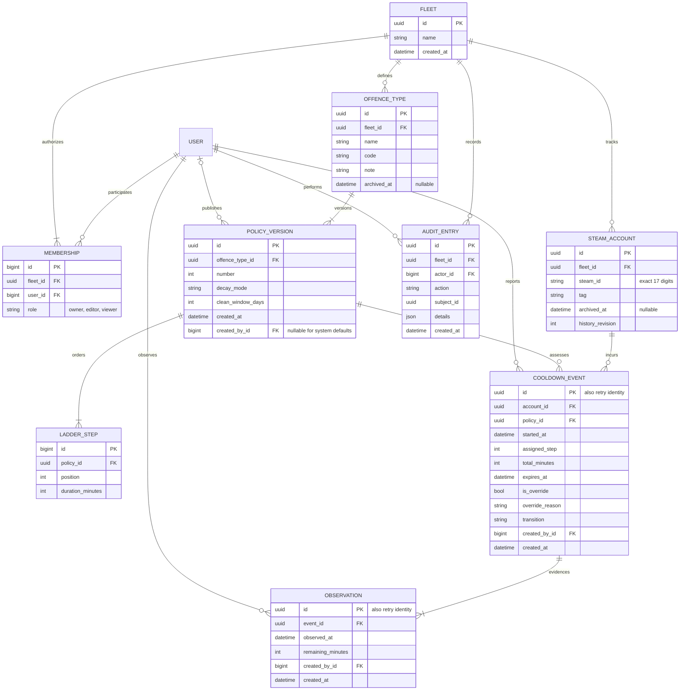

# Cooldown Counter data model

Implementation baseline: 2026-11-12. The user selected separate fleets with
membership and permissions, separate start/observation timestamps, historical
policy preservation, and archival instead of destructive type deletion.

The remaining choices below are implementation assumptions. They supersede
conflicting demo behavior, not the original evidence. The discovery catalog
remains a record of what was known before implementation.

## Entity relationship diagram

`USER` is Django's existing user model. Policy versions also retain their
creating user. Foreign keys protect historical facts from deletion. A user's
deactivation removes login access without destroying attribution.

## Ownership and constraints

Every account, offence type and audit entry belongs to one fleet. Events inherit
fleet ownership through their account; their policy must belong to that same
fleet. Observations inherit ownership through their event. Cross-fleet IDs are
rejected even when the caller belongs to both fleets. Membership lookup is
required at every API boundary, including object reads and preview requests.

Membership is unique per user/fleet. Owners manage membership and all editor
actions. Editors manage tracked accounts, rules and reports.
Viewers read only. Creating a fleet creates its owner membership atomically.
The last owner cannot be demoted or removed. Django admin provisions operator
accounts; public signup and password recovery are not introduced.

SteamID is a string, never a JavaScript number. It is unique within a fleet,
allowing another fleet to track the same real Steam account independently.
Offence names are unique without case distinctions within a fleet. Stable UUID
relationships survive renaming. Archived definitions remain available to history
but cannot be selected for new events. Archival never cascades into evidence.

Policy numbers are unique within an offence type. The greatest published number
is current. A new version owns a new set of ordered steps; published versions
and step rows are immutable through application services. Step positions are
contiguous and one-based, with at least one positive whole-minute duration.
Database constraints enforce positive values and unique positions; services
enforce multirow rules inside a transaction.

## Time and history

All stored instants are timezone-aware UTC. Input labels identify UTC, avoiding
ambiguous local date/time parsing. A day is 24 elapsed hours for decay. Calendar
days and date boundaries are UTC. Reports require start <= observed <= current
time. Remaining duration is a positive whole-minute value no greater than the
selected total. Blank, negative, nonfinite and fractional values are rejected;
there are no silent substitutions. Mixed duration components are additive.

A new cooldown event advances its account/type ladder once. Further observations
belong to that existing event and never advance it again. Event and observation
UUIDs identify retries; reusing an ID for different input is a conflict.

An event pins its policy, assigned step, total, expiry and transition explanation.
These assessment snapshots are retained even when new backdated evidence arrives.
Backdated reports are assessed using earlier events only. Future predictions use
the chronological known history and saved assessment states. History is therefore
an account of what was recorded, not an unannounced retrospective rewrite.

Overlapping events are supported. Clean time never starts before the latest
outstanding expiry for the account/type pair. Default decay drops one stored
level after each completed seven-day window, floored at zero. The next event
advances one step, capped at the policy's final step. Full-reset and no-decay
policies are explicit alternatives; expiry remains the anchor for all modes.
The hidden prototype start-anchor path is excluded because it conflicts with
the selected data-preserving model and visible guidance.

Manual overrides select a real step and require a reason. Preview returns the
current policy identity, account-history revision and number of prior same-type
offences effective at the entered start. Its explanation identifies completed
clean days from the expiry anchor and the selected decay mode. Recording locks the account
row and checks those tokens; a stale preview receives HTTP 409 for review. Type
publishing locks its parent type, serializing version numbers. Transactions
include their audit entry. Authoritative calculations live only in Python.

## Query and interface boundaries

The Django app is split into models, pure prediction functions, write services,
query projections, serializers and thin authenticated views. Small cohesive
units are preferred to tiny forwarding functions that add no boundary or rule.
The frontend consumes generated OpenAPI types and server-derived predictions.

Fleet summaries count distinct active accounts. Active means start <= now <
expiry. Clear accounts have no active event; no history is shown separately.
Calendar status filters classify their event records, with explicit labels;
offence and status dimensions apply to the same event. Fleet filters apply to
matching events for a selected offence. Calendar counts name unique cooldowns
and forecast marks separately, avoiding repeated weekly-segment counts.

Account selection uses UUIDs. Predictions name each offence and its next step.
No uncalibrated confidence labels are presented. Calendar overflow has an explicit
disclosure rather than an inaccessible lane cap. Earlier history, today and later
dates remain reachable without relying only on scrolling.

## Acceptance and limitations

The API bounds a calendar request to 1-366 UTC days and returns the latest 100
audit entries. Earlier/later calendar ranges remain selectable. Account tags and
offence names are bounded to 100 characters at the public interface, codes to
four characters, and notes/reasons to 2000 characters. Whole-minute scalar input
must fit a positive 32-bit database integer; policy validation also rejects a
forecast that exceeds the datetime range. These are interface/storage limits,
not claims about game rules or a measured production capacity.

Automated acceptance links executable cases to the 65 outcome IDs and their
atomic requirements. Approved alternatives and deliberately replaced demo
behavior must be recorded in that mapping rather than falsely marked as passed.
The implementation does not claim official Valve rule accuracy, production
load capacity or deployment validation. Rule defaults are editable model inputs.
No real Steam accounts or fabricated histories are seeded in ordinary startup.

## Supported browser baseline

The user selected desktop and mobile layouts from 320 CSS pixels wide with
200% text enlargement. Full-stack acceptance samples widths 320, 390, 768,
1024 and 1440 at normal and doubled text in Chromium, Firefox and WebKit.
The checks cover calendar entries, table columns, account detail, report inputs
and actions, and the rule editor. Labelled horizontal scrollers retain wide
table/calendar content while the outer page fits the viewport. Keyboard and
reduced-motion workflows are also tested. This is a concrete browser contract,
not a claim of complete accessibility certification.

Cross-tab notifications carry no credentials and never establish identity.
Browser policies that deny BroadcastChannel do not prevent login or restoration
of the server cookie session. Without that optional channel, other tabs check
their identity on reload and recover when protected reads reject expired access;
instant cross-tab notification cannot be guaranteed in that environment.
