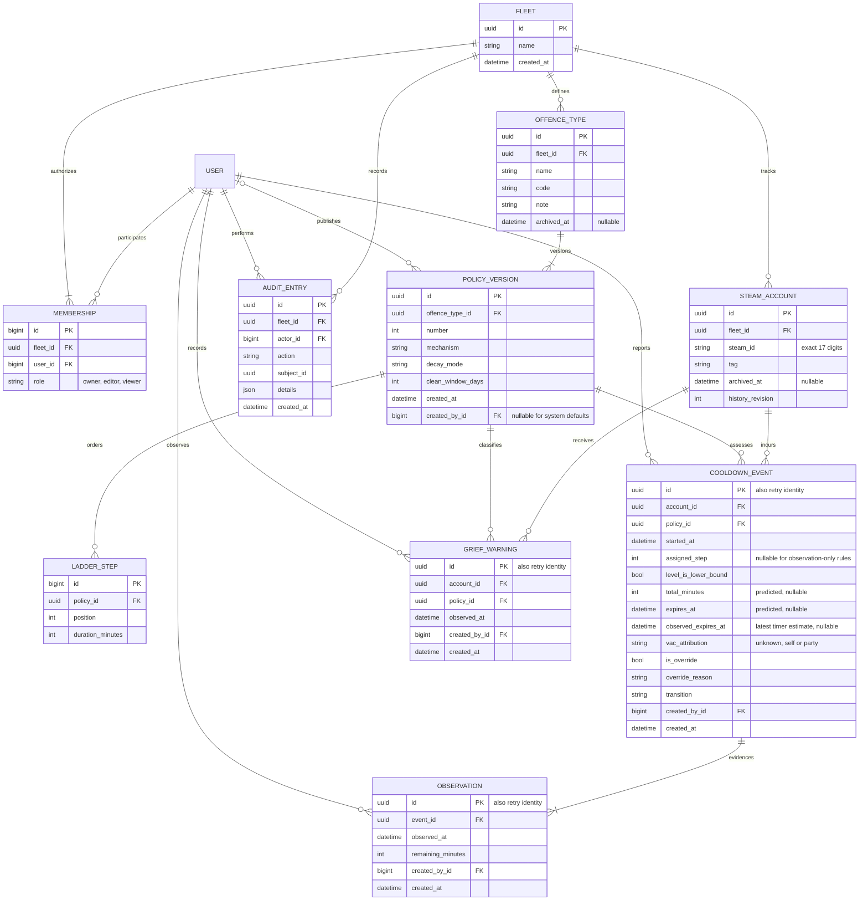

# Cooldown Counter data model

Each fleet owns its tracked accounts, reasons and policy revisions. An operator
records an issued restriction and the time shown in the game. The account's
assessment, timer evidence and any grief-report warnings have separate records.
The November 2026 model uses the published CS2 rules where they establish a
duration or progression. [CS2 cooldown model review](cs2-cooldown-model-review.md)

## Entity relationship diagram

`USER` is Django's existing user model. Policy versions also retain their
creating user. Foreign keys protect historical facts from deletion. A user's
deactivation removes login access without destroying attribution.

## Ownership and constraints

Every account, offence type and audit entry belongs to one fleet. Events inherit
fleet ownership through their account; their policy must belong to that same
fleet. Observations inherit ownership through their event. Cross-fleet IDs are
rejected even when the caller belongs to both fleets. Membership lookup is
required at every API boundary, including object reads and preview requests.

Membership is unique per user/fleet. Owners manage membership and all editor
actions. Editors manage tracked accounts, rules and reports.
Viewers read only. Creating a fleet creates its owner membership atomically.
The last owner cannot be demoted or removed. Django admin provisions operator
accounts; public signup and password recovery are not introduced.

SteamID is a string, never a JavaScript number. It is unique within a fleet,
allowing another fleet to track the same real Steam account independently.
Offence names are unique without case distinctions within a fleet. Stable UUID
relationships survive renaming. Archived definitions remain available to history
but cannot be selected for new events. Archival never cascades into evidence.

Policy numbers are unique within an offence type. The highest number is current.
Each published version pins its mechanism, parameters and ordered duration rows.
Game rules are selected by the stored mechanism. Renaming a reason leaves that
choice intact.

## Policy mechanisms and upgrades

| Mechanism | History used within one tracked account | Assessment |
| --- | --- | --- |
| Ordinary competitive | All issued ordinary events across reasons and policy versions | Shared level. Levels 1, 2 and 3 give 30 minutes, 2 hours and 24 hours. Level 4 and every higher level give 7 days. |
| VACNet | VACNet notices on this reason | Record the timer and its self, party or unknown attribution. The original total and next level are unknown. Valve describes all-mode restrictions and a repeat maximum of 180 days. |
| Griefing reports | Issued grief-report restrictions on this reason | Record the timer directly. A warning has its own record and leaves availability, cooldown counts and level unchanged. |
| Custom ladder | Custom events for this reason across its custom policy versions | The fleet supplies ordered positive whole-minute durations, a clean-window length and a decay mode. The last configured step is the maximum assigned level. |

New fleets start with Abandoning, Team Damage and Kicking using ordinary
progression. The VACLive and GriefReports reasons use their respective
observation-only mechanisms. Both have zero duration rows and no decay forecast.
A VACNet timer can exceed 30 days. A 180-day limit in the published rules is
context for an operator. The evidence field accepts readings above that value.

Migration `0002_game_cooldown_mechanisms` keeps all earlier policy revisions
custom, including ones with the old default names. This preserves fleet edits,
historical assessments and existing forecasts. To adopt a game mechanism, an
owner or editor opens the reason in the rule editor, chooses its mechanism and
saves a new version. Switch each qualifying ordinary reason that should share
the account level. The new version reads history already recorded under its
mechanism. A custom event recorded earlier stays in its original history. With
no ordinary history, the automatic estimate starts at level one. If a notice
shows a different tier, record the observation and review the override.
Renaming a reason or editing its description keeps the same policy. Editing
game duration parameters through an older client publishes a custom revision.

## Time and history

Reports use aware UTC times and require start <= observation <= current time.
A timer reading contains positive whole remaining minutes. For a game policy,
the latest reading by observation time gives the estimated release time
`observed_at + remaining_minutes`. A later correction can move the estimate
in either direction. A backfilled older reading stays in the evidence history.
For a custom policy the saved expiry still governs availability and readings
must fit its configured total.

Each issued restriction advances its applicable numeric progression at most
once. Adding another reading to that event cannot advance it again. Event,
observation and warning UUIDs identify retries. A changed body reusing the
same ID is a conflict. A grief warning needs no duration, never appears as a
cooldown, and cannot invalidate an existing preview.

The stored event pins the policy and the assessment accepted at reporting
time. VACNet and grief-report events have null assigned level, model duration
and predicted expiry. Their initial reading supplies an observed expiry
estimate. On game events, the API returns the effective release time in
`expires_at`, and exposes `predicted_expires_at` and `observed_expires_at`
separately. The former stays pinned when a new reading changes the latter.
Backdated previews consider only events and ordinary timer readings effective
at the entered start. Later reports preserve previously accepted assessments.

For an ordinary event the latest chronological event supplies the prior
level. The latest outstanding expiry in the shared progression anchors its
clean clock, including when intervals overlap. Every completed seven-day
period reduces the level by one, down to zero. Each new event adds one to
the resulting level. A fifth ordinary penalty can therefore still last seven
days and take an additional clean week to recover from. The tracker uses seven
elapsed periods of 24 hours as a week. Exact server boundaries, activity
requirements and overlap behavior remain assumptions.

A manual override selects one of the visible durations and requires a reason.
Choosing the ordinary seven-day tier by itself establishes a level of at least
four. A game timer longer than the saved prediction can also establish a higher
minimum. Subsequent ordinary predictions carry that lower bound forward, and
calendar markers and the next decay date are suppressed until the state is
known. Confirming one of the three shorter ordinary tiers by override
establishes an exact assigned level again. A reading partway through a penalty
provides remaining time only. It cannot identify the original total by itself.
An ordinary timer above seven days conflicts with all four published duration
bands. The discrepancy stays visible in history even when a later reading is
shorter. Review the reason and timestamps before relying on its level estimate.

For custom rules, step-down removes one level per complete clean window,
full-reset clears the entire level after one window, and no-decay retains it.
All three use the configured reason's history and saved expiries.

Preview returns the policy identity, account-history revision and number of
prior issued events in the relevant history. Recording locks the account and
checks those tokens. A stale preview receives HTTP 409 for review. Policy
publication locks its parent reason. The same transaction records the audit
entry. All escalation calculations run in Python.

## Query and interface boundaries

The Django app is split into models, pure prediction functions, write services,
query projections, serializers and thin authenticated views. Small cohesive
units are preferred to tiny forwarding functions that add no boundary or rule.
The frontend consumes generated OpenAPI types and server-derived predictions.

Fleet summaries count distinct active accounts. Active means start <= now <
effective expiry. Accounts with earlier expired events are clear. Accounts
without issued events are shown separately.
Calendar status filters classify their event records, with explicit labels;
offence and status dimensions apply to the same event. Fleet filters apply to
matching events for a selected offence. Calendar counts name unique cooldowns
and forecast marks separately, avoiding repeated weekly-segment counts.

Account selection uses UUIDs. Each reason names its mechanism. Numeric policies
show a next-step estimate. An unfiltered calendar shows one marker per shared
ordinary transition, even if several reasons use that progression.
No uncalibrated confidence labels are presented. Calendar overflow has an explicit
disclosure rather than an inaccessible lane cap. Earlier history, today and later
dates remain reachable without relying only on scrolling.

## Acceptance and limitations

The API bounds a calendar request to 1-366 UTC days and returns the latest 100
audit entries. Earlier/later calendar ranges remain selectable. Account tags and
offence names are bounded to 100 characters at the public interface, codes to
four characters, and notes/reasons to 2000 characters. Whole-minute scalar input
must fit a positive 32-bit database integer; policy validation also rejects a
forecast that exceeds the datetime range. These are interface/storage limits,
not claims about game rules or a measured production capacity.

Automated acceptance links executable cases to the 65 outcome IDs and their
atomic requirements. Approved alternatives and deliberately replaced demo
behavior must be recorded in that mapping rather than falsely marked as passed.
The implementation does not claim official Valve rule accuracy, production
load capacity or deployment validation. Operators can select game mechanisms or
use their own versioned custom rules.
No real Steam accounts or fabricated histories are seeded in ordinary startup.

## Supported browser baseline

The user selected desktop and mobile layouts from 320 CSS pixels wide with
200% text enlargement. Full-stack acceptance samples widths 320, 390, 768,
1024 and 1440 at normal and doubled text in Chromium, Firefox and WebKit.
The checks cover calendar entries, table columns, account detail, report inputs
and actions, and the rule editor. Labelled horizontal scrollers retain wide
table/calendar content while the outer page fits the viewport. Keyboard and
reduced-motion workflows are also tested. This is a concrete browser contract,
not a claim of complete accessibility certification.

Cross-tab notifications carry no credentials and never establish identity.
Browser policies that deny BroadcastChannel do not prevent login or restoration
of the server cookie session. Without that optional channel, other tabs check
their identity on reload and recover when protected reads reject expired access;
instant cross-tab notification cannot be guaranteed in that environment.
